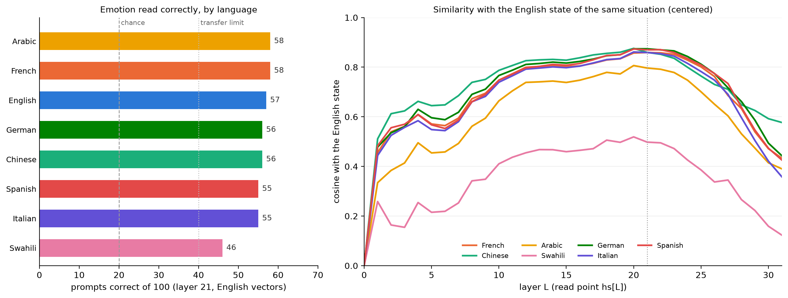

# emotion-vectors

A reproduction of Anthropic's paper [Emotion Concepts and their Function in a Large Language Model](https://transformer-circuits.pub/2026/emotions/index.html) on an open model, `Qwen/Qwen3.5-4B`.

It adds one question: do emotion vectors built from English stories detect the same emotions in text in other languages?

## Model and hardware

- Model: `Qwen/Qwen3.5-4B`, loaded with PyTorch in `bfloat16` on Apple MPS.
- Memory: the model uses about 8.4 GB.
- The notebooks were run on a Mac with 48 GB of RAM.

## Method

1. Claude Haiku wrote 150 short stories with the prompt from the paper: 5 emotions (happy, sad, calm, angry, afraid) × 10 topics × 3 stories. The prompt forbids each story's own emotion word.
2. For each story, take the residual stream at layer 21 (about two thirds of the way through the model) and average it from token 50 onward.
3. Emotion vector = mean of the stories of one emotion − mean of all stories.
4. Test set: 100 situations that people wrote, from EmpatheticDialogues, 20 for each emotion, with no emotion words. Also 20 neutral prompts.
5. Put each prompt in the chat template and read layer 21 at the last token before the reply. Subtract the mean of the neutral prompts. The emotion vector with the highest cosine is the answer.
6. Translate the 120 prompts into 7 languages and do the same test with the same English vectors. Each language is centered on its own neutral prompts.

The pass rule was set before each run: 40 or more of 100 correct, and the diagonal of the mean-cosine table is the row maximum in at least 4 of 5 rows. Fewer than 30 correct is a fail. Chance is 20%.

## Results

From the printed output of `notebooks/02_emotion_vectors.ipynb`, section 11. Layer 21, last token, English vectors.

| Language | Correct (of 100) | Same answer as English (of 100) | Cosine with the English state, layer 21 |
|---|---|---|---|
| English | 57 | 100 | 1.00 |
| French | 58 | 80 | 0.86 |
| Chinese | 56 | 81 | 0.86 |
| Arabic | 58 | 83 | 0.80 |
| Swahili | 46 | 64 | 0.50 |
| German | 56 | 77 | 0.87 |
| Italian | 55 | 78 | 0.86 |
| Spanish | 55 | 84 | 0.87 |

"Same answer as English" is the number of prompts where the answer is the same as for the English twin. The cosine is between the state of a translated prompt and the English state of the same situation.

With the pass rule, English is a strong pass. Swahili is a partial transfer. The other six languages are a transfer.



### Caveats

- There are only 5 emotions, and 30 stories for each emotion.
- The calm vector does not work in this test: 0 of 20 calm prompts are correct in every language. The neutral baseline removes it.
- Claude translated the prompts. Native speakers did not check the translations.
- EmpatheticDialogues has no "calm" label. The test uses "content", which is closer to "satisfied".
- This is one model and 100 prompts for each language.
- For Swahili, a lower score can mean that the model understands Swahili less well. It does not show that the vectors are English-only.

## Repository layout

| Path | Contents |
|---|---|
| `notebooks/00_explore.ipynb` | Load the model. Tokenizer, hidden states, residual norms. |
| `notebooks/01_stories.ipynb` | Build the stories dataset from `data/raw/`. |
| `notebooks/02_emotion_vectors.ipynb` | Emotion vectors, cosine similarity, logit lens, implicit prompts, other languages. |
| `src/emotion_vectors/` | Prompt templates. |
| `data/raw/` | Generated stories, one file for each emotion. |
| `data/stories.jsonl` | Clean stories dataset. |
| `data/emotion_vectors.pt` | Emotion vectors. |
| `data/implicit_prompts*.jsonl` | Test prompts in English, and in ar, de, es, fr, it, sw, zh. |
| `data/empathetic_dialogues/` | EmpatheticDialogues CSV files (notebook 02, section 8b). |
| `data/README.md` | Source and licence of each data file. |
| `outputs/` | Figures from notebook 02. |

## How to run

You need [uv](https://docs.astral.sh/uv/) and Python 3.12.

```
uv sync
```

Then run the notebooks in order: `00_explore`, `01_stories`, `02_emotion_vectors`. They use relative paths, so start them from the `notebooks/` directory.

`data/story_acts.pt` (cached activations) is not in git. Notebook 02, section 3 rebuilds it.

## Licence and data

The code is under the MIT licence. See [LICENSE](LICENSE).

The files in `data/empathetic_dialogues/` are third-party data from EmpatheticDialogues (Rashkin et al., 2019), from the Hugging Face mirror `bdotloh/empathetic-dialogues-contexts`. The mirror gives the licence as CC BY-NC 4.0. The MIT licence does not cover them. The implicit prompts contain text from this dataset.

Claude Haiku wrote the stories. Claude wrote the neutral prompts and the translations. See [data/README.md](data/README.md) for each file.

## Related work

- Anthropic, *Emotion Concepts and their Function in a Large Language Model*: https://transformer-circuits.pub/2026/emotions/index.html
- Reichman, Avsian, Heck, *Emotions Where Art Thou*: https://arxiv.org/abs/2510.22042
- Xue et al., *Cross-lingual Functional Vectors for Emotion Detection in Large Language Models*: https://arxiv.org/abs/2608.29613
- Zhang, Zhong, *Decoding Emotion in the Deep*: https://arxiv.org/abs/2510.04064
- Wendler et al., *Do Llamas Work in English?*: https://arxiv.org/abs/2402.10588
- Yang, Kautz, Hatamizadeh, *Gated Delta Networks*: https://arxiv.org/abs/2412.06464
